# Naturkatastrophen – Bericht

Spezifikation: [../ereignisse-spec.md](../ereignisse-spec.md) · Effekt-Stil: [stil.md](stil.md)

## Stufe 2: Ausbau (15. 10. 2026)

**Stand:** Alle Katastrophen mit Regel laufen im Spiel über den neuen Ablauf: Werkzeug wählen, auf ein Feld klicken.
Der Test-Auslöser `?hazards=1` ist entfallen. Die Seuche nutzt bis zum Merge der Zivilisation den alten Pinsel.

### Aufnahmen

| Ereignis | Animation | Bildfolge |
|---|---|---|
| Flächenbrand | [brand.png](brand.png) | 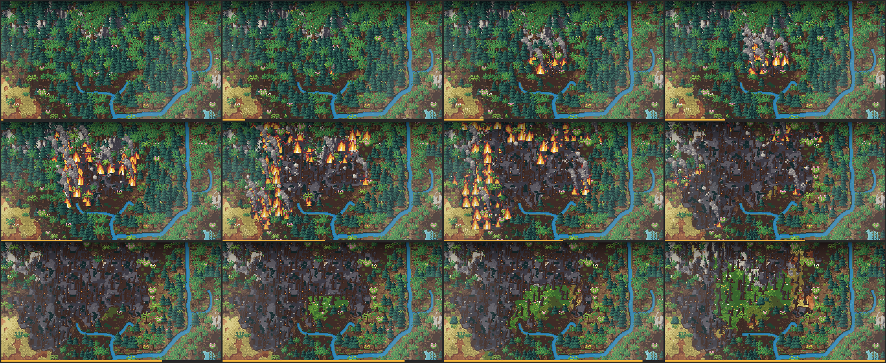 |
| Meteorit | [meteorit.png](meteorit.png) | 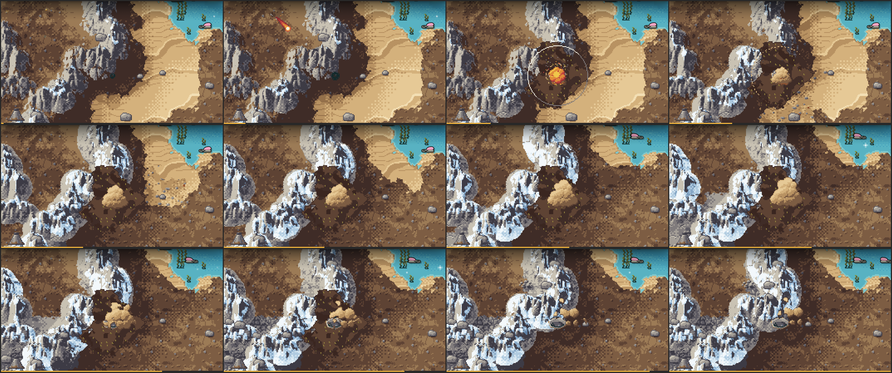 |
| Meteorit im Meer (Fontäne, Folge: Flutwelle) | – | 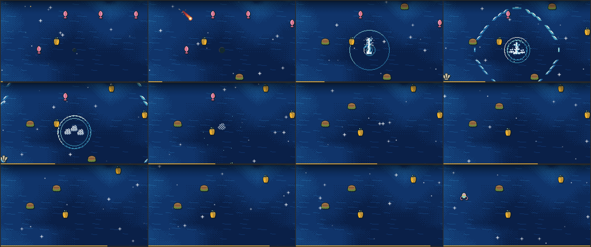 |
| Atomschlag | [atomschlag.png](atomschlag.png) | 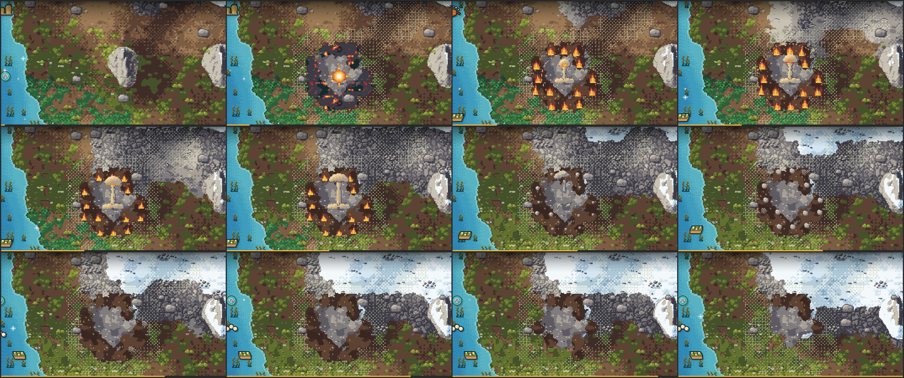 |
| Flutwelle | [flutwelle.png](flutwelle.png) | 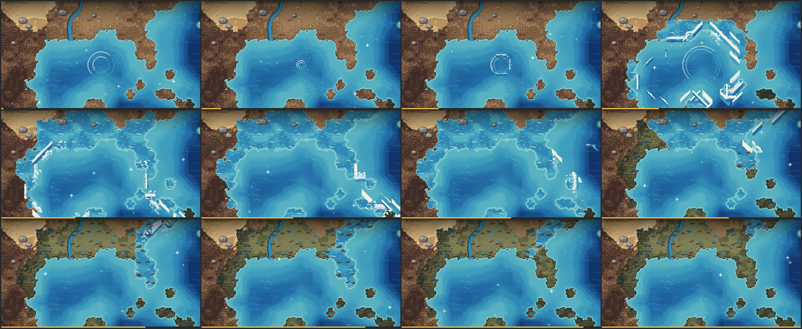 |
| Flutwelle: Kämme in mehreren Richtungen, brechende Wellen | – | 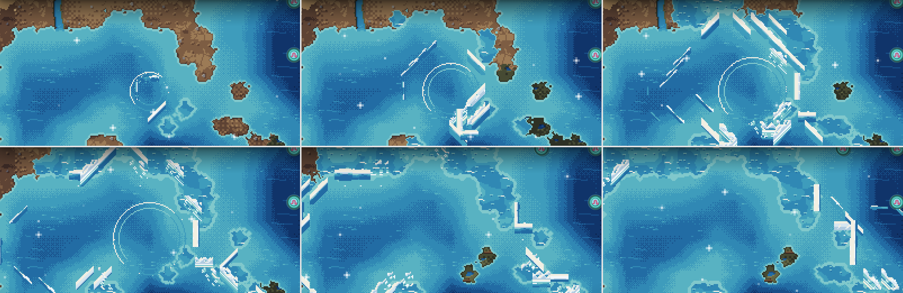 |
| Wirbelsturm mit Landgang und zwei Tornados | [wirbelsturm.png](wirbelsturm.png) | 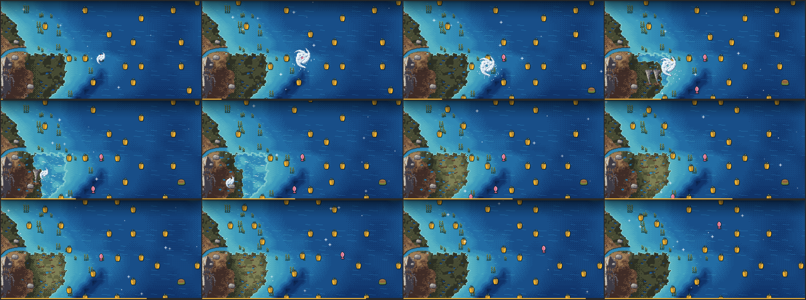 |
| Erdbeben | [erdbeben.png](erdbeben.png) | 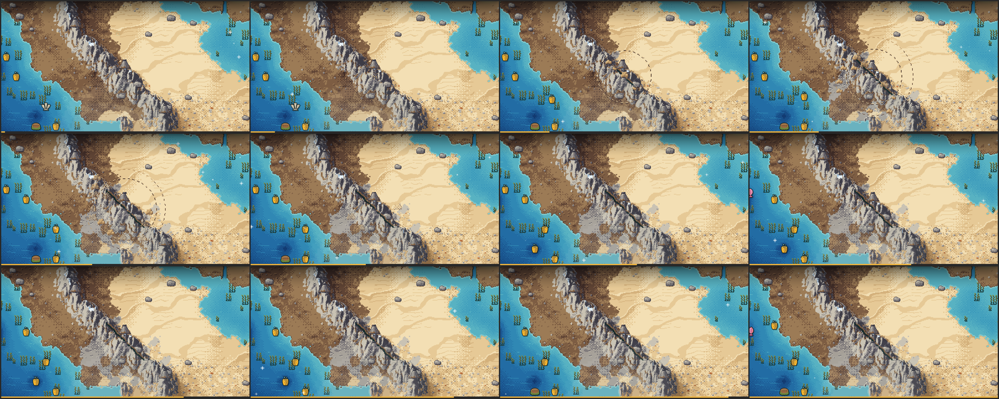 |

[effekte-kontaktbogen.png](effekte-kontaktbogen.png) zeigt alle 34 Effekt-Sprites und 11 Boden-Texturen. Auf den
Proben-Planeten liegt nach Einschlägen oft Schnee: Das ist der weltweite Staub (K6), nicht die Effektebene.

### Was dazukam

- **Vulkan:** Ausbruchssäule mit 8 Bildern, Lavaspritzer aus dem Krater.
- **Flächenbrand:**
  - Flammen in 3 Größen mit je 6 Bildern; die Größe folgt dem Brennstoff und der Brenndauer.
  - Rauchfahnen neigen sich mit dem Wind. Der Westwind-Satz ist im Generator gespiegelt und neu belichtet.
  - Neu gestaltet: das Vorzeichen (Rauchfaden, Glimmen), das Aufflammen und das Nachglimmen.
- **Meteorit und Atomschlag:**
  - Staubwolke und Pilzwolke mit je 8 Bildern.
  - Wasserfontäne, Gischt und Dampf bei einem Meteoriten im Meer.
  - Bei 10 px je Kachel ist der Schatten jetzt eine Rasterscheibe.
  - Im Aschezentrum bleiben höchstens 2 der 4 Ecken Asche; es wirkt dadurch rund.
- **Flutwelle:**
  - Wellenkämme in 8 Richtungen, tief und küstennah. Jede Richtung ist im Generator aus demselben Körper neu
    gezeichnet und belichtet.
  - An der Küste bricht die Welle. Nur die vorderste Reihe der Front trägt einen Kamm.
- **Wirbelsturm:**
  - Spirale mit 8 Bildern.
  - Tornados: Beim Landgang mit Stärke ≥ 3 setzen 1–2 Trichter auf. Sie ziehen 2–4 Felder landeinwärts, werfen
    Wald um und beschädigen Städte.
- **Erdbeben:**
  - Der Riss ist eine flache Bodenzeichnung aus Mittel-, End- und Abzweigstücken, die pixelgenau aneinanderpassen.
  - Er liegt in einem eigenen Pass direkt nach dem Boden. Herden laufen darüber, Bäume auf dem Feld und in der Zeile
    davor bleiben davor.
  - Hangrutsche verschütten den Riss nicht mehr.
  - Die Bodenwellen sind auch auf Sand sichtbar.
- **Kettenreaktionen** (§3.9, `hazardchain.ts`):
  - Erdbeben oder Meteorit im Meer → Flutwelle.
  - Lava oder die Druckwelle eines Meteoriten neben trockenem Bewuchs (Deckung ≥ 0,35, Feuchte < 0,4) →
    Flächenbrand.
  - Höchstens eine Folge je Ereignis; Folgen lösen nichts weiter aus.
- **„Zum Ereignis springen“:**
  - Die Meldung nennt Folgeereignisse („Erdbeben! Folge: Flutwelle.“) und hat einen Knopf, der die Kamera hinfliegen
    lässt.
  - „Zum letzten Ereignis springen“ im Menü fliegt zum laufenden oder letzten Ereignis; beim Wirbelsturm zum Auge.
- **Markierung auf der herausgezoomten Karte:** Unter 16 px je Feld zeigt jedes laufende Ereignis zwei pulsierende
  Pixelringe.
- **Kleinigkeiten:** Erstarrende Lava behält ihre Kruste einen Tick länger. So blitzt kein alter Boden mehr auf (R1,
  V4).

### Review R2

Alle Ereignisse, die Ketten, der Sprung-Knopf und die Markierung bestanden. Die Korrekturen aus R1 halten. Behoben:

- Die Kette des Vulkans wählte schon beim Start ein Feld neben dem Schlot. Die Lava floss im ersten Tick darüber, und
  der gemeldete Brand erlosch sofort. Jetzt brennt es erst neben erstarrter Lava und nur oberhalb ihrer Oberfläche.
- Auf Retina- und Handy-Bildschirmen fehlte die Markierung beim Herauszoomen. Sie richtet sich jetzt nach der
  Kachelgröße auf dem Bildschirm, nicht nach Gerätepixeln.
- Windwurf hielt nach einem Wirbelsturm 25 Ticks statt 12–16, weil die Narbe auf nassem Boden nicht alterte. Nur
  noch Lava, Flut und Feuer halten das Altern an.
- Bei „Schnell“ blitzte beim Erstarren der Lava noch kurz alter Boden auf. Die Kruste bleibt jetzt liegen, bis das
  Grundbild der Karte nachgezogen hat.
- Die Flutwelle nach einem Seebeben startete in voller Stärke. Jetzt hat sie 0,25 · M einer vollen Welle.
- Versetzte Riss-Stücke konnten Bäume der Nachbarzeile überdecken. Jetzt zeichnet die Effektebene jede Zeile nach,
  die ein Bodenbild berührt.
- Das Aufnahme-Werkzeug beachtet `--site` jetzt auch bei der Flutwelle.

Offen:
- Das Feuer kostet bei 32 px und 4 Bränden im p95 bis 3,9 ms, mehr als die 3 ms aus §5 (im Mittel 1,8 ms).
- R2 beobachtete, dass nach einem Erdbeben Bäume in der Umgebung verschwinden. Vermutlich reagiert das Gelände der
  Höhen-Aufgabe auf die Hebung; die Ursache ist nicht geklärt.

### Messwerte

- **Leistung:** Effektebene mit je 4 gleichzeitigen Ereignissen, 1280 × 720, 32 px, Mittel / p95 in ms, gemessen von
  den Agenten.

  | Ereignis | ms |
  |---|---|
  | Flächenbrand (dichter Wald) | 1,5–1,7 / 3,3–3,7 |
  | Meteorit | 0,5 / 1,2 |
  | Atomschlag | 0,6 / 1,4 |
  | Flutwelle | 0,6–0,9 / 1,8–2,1 |
  | Wirbelsturm | 0,5–0,6 / 1,4 |
  | Erdbeben | 0,5 / 1,2 |

  Beim Start eines Ereignisses bleibt die einmalige Spitze von 25–40 ms (Neuberechnung von Flüssen und Weltwerten).
- **Tests:**
  - 81 Katastrophen-Tests einschließlich Atlas- und Gelände-Renderer, alle grün; neu ist
    `tests/hazard-chain.test.js`.
  - Die ganze Suite: 248 von 251. Die 3 Fehlschläge (Evolutionsbaum, Begrünung) kommen aus der angehaltenen Arbeit
    der Höhen-Aufgabe im Arbeitsbaum.

### Einschränkungen

- **Natürliche Katastrophen und Speicherstand:**
  - Natürliche Katastrophen laufen weiter über den alten Pinsel in `geo.ts`. Narben und laufende Ereignisse werden
    noch nicht gespeichert und wandern noch nicht mit der Plattendrift.
  - Beides kommt nach dem Merge der Höhen-Aufgabe (K1), ebenso die echten Basalt- und Schutt-Böden und die Anhebung
    der Effekte auf Gebirgskämmen (Schrägansicht der Höhen-Aufgabe).
- **Die Seuche** folgt nach dem Merge der Zivilisation.
- **Nicht geprüft:** andere Browser, echte Touch-Geräte und das Gefühl der Inszenierung im Spiel.

## Stufe 1: alle Ereignisse in der Grundversion (15. 10. 2026)

**Stand:** Vulkan, Flächenbrand, Meteorit, Atomschlag, Flutwelle, Wirbelsturm und Erdbeben laufen im neuen Ablauf:
- ein Feld als Ziel
- Vorzeichen, Hauptanimation in Echtzeit
- Ausbreitung je Tick
- Narbe, die über die Sukzession heilt

Die Seuche folgt nach dem Merge der Zivilisation. Der unabhängige Review R1 ist durch, seine Funde sind eingearbeitet
(unten).

### Aufnahmen

Die animierten PNGs laufen im Browser. Die Bildfolgen zeigen 12 Bilder aus derselben Aufnahme. Der gelbe Balken
unten zeigt, wann ein Bild in der Aufnahme lag.

| Ereignis | Animation | Bildfolge | Was man sieht |
|---|---|---|---|
| Vulkan | [vulkan-binnenland.png](vulkan-binnenland.png) | 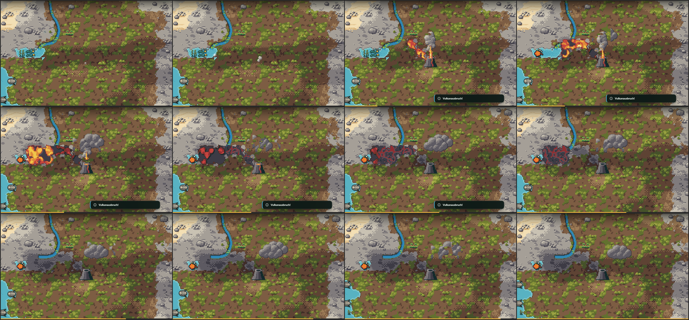 | siehe Abschnitt zur Vulkan-Referenz unten |
| Flächenbrand | [brand.png](brand.png) |  | Rauchfaden, Flamme, Ausbreitung Feld für Feld mit dem Wind, Glut, verbrannte Erde mit verkohlten Stämmen; [brand-heilung.png](brand-heilung.png): Zeitraffer, der Wald wächst nach |
| Meteorit | [meteorit.png](meteorit.png) |  | wachsender Schatten, Feuerschweif, Blitz, Staubwolke, Krater mit Rand, versengte Ringe |
| Atomschlag | [atomschlag.png](atomschlag.png) |  | Lichtpunkt, Blitz, Druckring, Pilzwolke, Feuerring, Asche im Zentrum, fahler Fallout-Schleier mit dem Wind |
| Flutwelle | [flutwelle.png](flutwelle.png) |  | Wellenkamm läuft über das Meer, schnell in der Tiefsee, langsam im Flachen; Auflaufen an flachen Küsten, Abfließen, Schlamm mit Treibgut |
| Wirbelsturm | [wirbelsturm.png](wirbelsturm.png) |  | Sturm formt sich, zieht mit dem Passat, wird über warmem Meer stärker; Regen, nasser Boden, Sturmflut an der Küste |
| Erdbeben | [erdbeben.png](erdbeben.png) |  | Beben, gestrichelte Bodenwellen, Riss öffnet sich vom Epizentrum aus, Hangrutsche mit Schutt; [erdbeben-stadt.png](erdbeben-stadt.png): Stadt vorher, währenddessen, danach (Ruine, Trümmer) |

[effekte-kontaktbogen.png](effekte-kontaktbogen.png) zeigt alle 26 Effekt-Sprites und 11 Boden-Texturen.

Die Aufnahmen von Atomschlag und Flutwelle sind nach dem Review neu entstanden. Sie zeigen schon die Schneeberge der
Höhen-Aufgabe, deren Gelände im Arbeitsbaum liegt.

### Was dazukam

- **Flächenbrand:**
  - Zellautomat je Tick. Er brennt eher in trockenem, heißem, holzigem Bewuchs und mit dem Wind.
  - Wasser, Flüsse, kahler Boden und Verbranntes halten ihn auf.
  - Höchstens 90 Felder, Reichweite 10, 40 Ticks.
- **Meteorit:**
  - Krater auf dem Zielfeld (−0,06 Höhe), versengte Ringe.
  - Im Meer nur Gischt und Dampf.
  - Die Ringe sind gerundete Abstände mit gehashtem Wackeln, damit die Narben rund und ausgefranst werden.
- **Atomschlag:**
  - Asche im Zentrum, Ring 2 versengt und 2 Ticks brennend.
  - Fallout über Ring 3 und eine Fahne mit dem Wind. Dort stirbt das Leben 20 Ticks lang weiter.
- **Flutwelle:**
  - Ankunftsfeld über das Wasser (schnell in der Tiefsee, langsam im Flachen), Energie nimmt mit dem Weg ab.
  - An der Küste läuft das Wasser je Tick ein Feld auf, nur unter seiner Resthöhe. Dann steht es und fließt ab.
  - Danach bleibt Schlamm.
- **Wirbelsturm:**
  - Das Auge zieht ein Feld je Tick: in den Tropen mit dem Passat nach Westen, jenseits von 30° nach Osten, dazu
    polwärts.
  - Er wird über warmem Meer stärker und verliert über Land.
  - Wirkung: Nässe, Windwurf in Wäldern, Sturmflut beim Landfall.
- **Erdbeben:**
  - Riss aus 2·M+1 Feldern: an Plattengrenzen waagrecht (M 3), sonst entlang des Gebirges (M 2).
  - Versatz einer Seite, Hangrutsche mit Schutt.
  - Städte werden beschädigt oder liegen ein paar Ticks in Trümmern.
- **Narben, gemeinsam für alle Ereignisse:**
  - Eine Narbe heilt höchstens bis zur Stufe, die das Feld vorher hatte. Eine verbrannte Steppe wird wieder Steppe,
    kein Wald.
  - Verkohlte Stämme und Stümpfe gibt es nur, wo vorher Gebüsch oder Wald stand.
  - Fallout wartet unter Asche, Versengung und späteren Narben und übernimmt beim selben Alter. So heilt die Zone
    zusammen.
  - Ruinen räumt eine neue Stadt weg.
- **Untersuchen-Fenster:** Es zeigt Zustand und Narbe des Feldes, z. B. „Verbrannte Erde, wächst nach“ oder „Brennt“.

### Review R1

Geprüft wurde jedes Ereignis in mehreren Biomen und an mehreren Küstenformen, bei 10, 16 und 48 px je Kachel, mit und
ohne „Effekte reduzieren“, dazu der Code. Vulkan, Flutwelle, Wirbelsturm und Erdbeben waren in Ordnung. Behoben:

- Bei ausgeschalteter Ebene „Ereignisse auf der Karte“ startete ein Ereignis nie, die Energie war trotzdem weg.
- Bei zwei Auslösungen auf dasselbe Feld während des Vorzeichens war die zweite bezahlt, aber wirkungslos. Jetzt gibt
  es die Energie zurück und eine Meldung.
- Eine neue Narbe (Flut, Brand) löschte den Fallout.
- Ruinen blieben unter einer neu gegründeten Stadt.
- Abgeräumte Baumkronen blieben bis zum nächsten Tick als Streifen über Pilzwolke und Kraterrand stehen.
- Das Wackeln wurde am linken Bildrand außerhalb des Bildes gezeichnet.
- Windwurf endete immer nach genau 13 Ticks statt nach 12–16.
- Beim Feuer wurden die Verdecker jeden Tick neu gebaut. Dadurch sank die Spitze des Objekt-Passes von 7,8–11,8 ms
  auf 3,1 ms.
- Kleinigkeiten:
  - genauere Meldungen beim Feuer (Wasser, zu nass, schon verbrannt)
  - Zustand der Effekt-Skripte beim Planetenwechsel zurückgesetzt
  - zwei Spielwerte nach `constants.ts` verschoben
  - `hazard-probe --green` gibt dem Feuer Brennstoff

Offen für Stufe 2:
- Bei 10 px je Kachel ist der Meteoritenschatten eine Fläche statt einer Rasterscheibe.
- Wenn Lava erstarrt, zeigt sich für etwa 0,5 s ein heller Fleck (Ursache noch nicht geklärt).
- Das Aschezentrum des Atomschlags (3×3 Felder) wirkt noch kantig.

### Messwerte

- **Leistung:** Headless Chrome, 1280 × 720, Tempo „Schnell“, je 4 Ereignisse gleichzeitig, Effektebene in ms je Frame
  (Mittel / p95). Die Werte stammen aus Review und Nachmessung.

  | Ereignis | 32 px | 16 px |
  |---|---|---|
  | Vulkan | 0,7 / 2,1 | – |
  | Flächenbrand | 1,1 / 2,3 | 1,8 / 3,6 |
  | Meteorit | 0,8 / 1,7 | – |
  | Atomschlag | 0,8 / 2,1 | – |
  | Flutwelle | 1,0 / 2,7 | – |
  | Wirbelsturm | 0,4 / 1,1 | – |
  | Erdbeben | 0,6 / 2,1 | – |

  - Ohne jedes Ereignis fällt das Spiel bei „Schnell“ und 16 px schon auf einen Frame-Abstand von 33 ms (p95). Das ist
    die Grundlast der Simulation, nicht die Effektebene.
  - Beim Start eines Ereignisses gibt es weiter einmal eine Spitze von 25–70 ms: Neuberechnung der Flüsse und der
    Weltwerte, wie beim alten Auslöser.
- **Simulation:** 8 Ereignisse gleichzeitig kosten 0,4 ms je Tick (p95 1,4).
- **Tests:** 44 Katastrophen-Tests (`tests/hazards.test.js`, `hazard-fire`, `hazard-impact`, `hazard-quake`,
  `hazard-water`, `fxatlas`), alle grün. Die ganze Suite lief vor der Höhen-Aufgabe mit 196 von 196 durch. Mit deren
  Zwischenstand im Arbeitsbaum schlagen 8 Tests zu Planetenerzeugung, Evolutionsbaum und Gründungen fehl; keiner davon
  betrifft die Katastrophen.

### Einschränkungen

- **Neuer Ablauf nur per Test-Auslöser:** Alle Ereignisse laufen nur über `index.html?hazards=1`. Natürliche
  Ereignisse nutzen weiter den alten Pinsel in `geo.ts`. Umgestellt wird nach dem Merge der Höhen-Aufgabe (K1).
- **Nicht gespeichert:** Narben und laufende Ereignisse sind noch nicht im Speicherstand, und sie wandern noch nicht mit
  der Plattendrift. Beides kommt mit Speicherformat 9, nach Format 8 der Höhen-Aufgabe.
- **Basalt und Schutt sind Platzhalter.** `raiseCrust` und die echten Materialien liegen inzwischen im Arbeitsbaum der
  Höhen-Aufgabe; umgestellt wird nach ihrem Merge.
- **Hurrikane der Stärke 3 und mehr sind auf der heutigen Erde selten**, weil das Meer dort selten 26 °C erreicht.
  Windwurf braucht Wald der Stufe 4 und war in den Proben kaum zu sehen; die Tests decken ihn ab.
- **Noch nicht in Stufe 1** (geplant für Stufe 2):
  - Kettenreaktionen
  - „Zum Ereignis springen“, die Markierung auf der herausgezoomten Karte
  - mehr Frames, Wellenkamm in 8 Richtungen mit brechender Welle
  - Tornados, die Seuche
  - die längere Haltezeit der Brandflächen (braucht `succession.ts`, erst nach dem Merge der Höhen-Aufgabe)
- **Nicht geprüft:**
  - Regenwald und Savanne (fehlten auf den Proben-Planeten)
  - Bucht und Landzunge, mehrere Städte gleichzeitig
  - Laden mit laufenden Ereignissen im Browser
  - andere Browser, echte Touch-Geräte und das Gefühl der Inszenierung im Spiel

## Stufe 1: Fundament und Vulkan-Referenz (14. 10. 2026)

**Stand damals:** Das Fundament stand, der Vulkanausbruch war als Referenz fertig und wurde freigegeben.

### Aufnahmen

Alle mit Seed 4242, nach 1500 Ticks, Tempo „Mittel“ (400 ms je Tick). Der Zeitbalken unter jedem Bild zeigt, wann es
in der Aufnahme lag.

| Bild | Inhalt |
|---|---|
| [vulkan-binnenland.png](vulkan-binnenland.png) | animiertes PNG (läuft im Browser), 10 s, 48 px je Kachel |
|  | dieselbe Aufnahme als Bildfolge: Vorzeichen, Säule, Lavastrom bergab bis in den See, Abkühlen, Basalt, abziehende Asche |
| 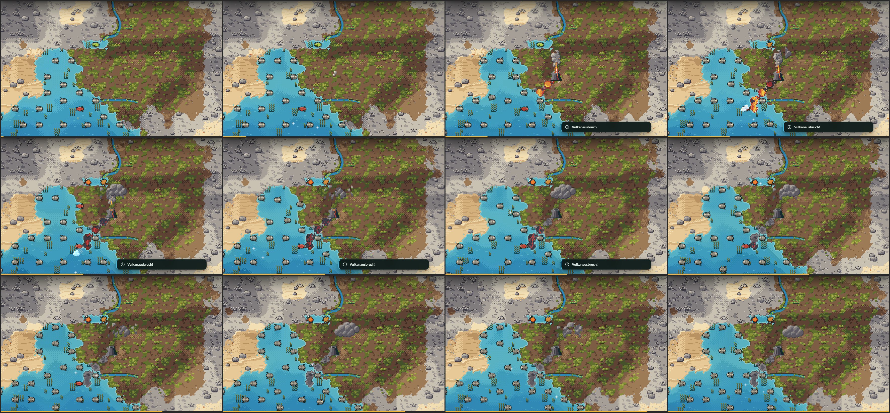 | an der Küste: Lava läuft ins Meer, Dampf, neues Land aus Basalt |
| 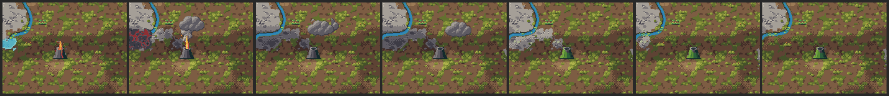 | Zeitraffer über 261 Ticks (Tempo „Schnell“, 24 px je Kachel): Ausbruch → Kruste → Basalt → Flechten-Fels → Grün; der Schlot glüht, ruht dunkel und wird erst mit dem Umland grün; er raucht ab und zu |
| 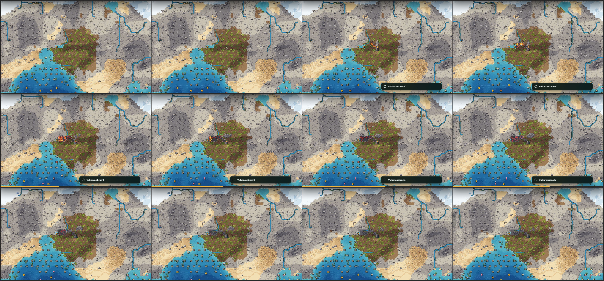 | dieselbe Stelle bei 16 px je Kachel |
| [effekte-kontaktbogen.png](effekte-kontaktbogen.png) | alle Effekt-Sprites und Boden-Texturen (inzwischen aller Ereignisse), 1× und 4× |

### Was gebaut ist

- **Ablauf:**
  - Ein Ereignis beginnt auf genau einer Kachel. Die Zielmarkierung ist eine Kachel.
  - Das Vorzeichen spielt in Echtzeit (K2), dann startet das Ereignis in der Simulation.
  - Die Ausbreitung läuft je Tick, die Hauptanimation in Echtzeit.
  - Zufall kommt aus Hash-Würfen, nie aus `world.rng`.
  - Höchstens 8 Ereignisse laufen gleichzeitig.
- **Vulkan:**
  - Kegel +0,20 Höhe, Ring +0,06.
  - Lava fließt bergab und verzweigt sich. Sie steht 0,03 dick und fließt deshalb über kleine Buckel und aus flachen
    Mulden.
  - Abkühlen: glühend → dunkelrot → Kruste → Basalt.
  - Wasser stoppt die Lava mit Dampf. Höchstens 2 flache Wasserkacheln werden zu Land.
  - Im Schelfmeer entsteht eine Insel, in der Tiefsee nur Dampf (K5).
  - CO₂ und Staub wie bisher (K6). Ascheregen kostet Städte bis 2 Kacheln Entfernung 15 %.
- **Bodenzustände:**
  - Eigenes Feld je Kachel. Basalt, Schutt und Schlamm zeichnet das Gelände; alle anderen Narben-Böden zeichnet die
    Effektebene mit den Randmasken des Geländes.
  - Die Mindestzeiten sind gestaffelt (K3): Brand 12, Schlamm 10 … Basalt 60, Krater 80, Fallout 150 Ticks.
  - Solange ein Zustand jung ist, wird die Störung jeden Tick über die vorhandenen Sukzessions-Funktionen erneut
    angewendet. `succession.ts` bleibt dadurch unverändert.
- **Effektebene:**
  - Pässe für Wackeln, Boden, Objekte und oben.
  - Verdecker: Bäume und Städte der Zeile davor.
  - Partikel-Pool, pixelgenaue Ringe.
  - Skalierung wie das Gelände (nächster Nachbar auf ganze Vielfache, dann weich).
  - Lava wird durch die Randmasken des Geländes gelegt, Pflanzen liegen darüber.
- **Einstellung** „Effekte reduzieren (kein Wackeln, keine Blitze)“ im Menü Optionen. Standard ist der Systemwunsch
  nach weniger Bewegung.
- **Werkzeuge:**
  - `tools/fx-atlas.js` erzeugt die Effekt-Sprites aus Rezepten.
  - `tools/fx-record.js` nimmt auf und misst die Leistung.
  - `tools/hazard-probe.js` liefert Reichweiten und Heilzeiten.

### Messwerte

- **Probe** (Zufallsplanet, Seeds 777, 4242, 12345, mit Pflanzen rings um die Stelle):
  - Binnenland: 7–10 Lavakacheln, Reichweite 3–5, nach 13–16 Ticks vorbei. Der Basalt verheilt nach 58–62 Ticks.
  - Küste: 1–3 Kacheln neues Land.
  - Schelf: Insel, nur der Schlot bleibt.
  - Tiefsee: 0 Narben.
- **Leistung** (Headless Chrome, 1280 × 800, 32 px je Kachel, Tempo „Schnell“):
  - 1 Ausbruch: Effektebene 0,5 ms je Frame (p95 2,2).
  - 4 Ausbrüche: 0,6 ms (p95 2,3).
  - 8 Ausbrüche: 1,2 ms (p95 3,0).
  - Das Spiel läuft mit 60 fps.
  - Einmal pro Ereignis gibt es eine Spitze von bis zu 60 ms, wenn es in der Simulation startet: Neuberechnung der
    Flüsse und der Weltwerte. Der alte Auslöser kostete dasselbe beim Klick.
- **Tests:**
  - neu: `tests/hazards.test.js` (7) und `tests/fxatlas.test.js` (3)
  - ganze Suite gegen das eigene Bundle: 156 von 156 grün

### Einschränkungen

- **Nur der Spieler-Vulkan nutzt den neuen Ablauf**, und nur über den Test-Auslöser `index.html?hazards=1`. Natürliche
  Ausbrüche laufen weiter über den alten Pinsel in `geo.ts`. Umgestellt wird nach dem Merge der Höhen-Aufgabe (K1).
- **Nicht gespeichert:** Bodenzustände und laufende Ereignisse gehen beim Laden verloren, bis das Speicherformat nach
  dem Merge der Höhen-Aufgabe erweitert wird.
- **Basalt ist vorläufig** dunkel schattierter Fels. Das echte Material und `raiseCrust` kommen von der Höhen-Aufgabe;
  bis dahin läuft beides über `src/hazardadapter.ts`.
- **Bei 10–16 px je Kachel** ist ein Ausbruch klein, so wie es die lokale Ausdehnung vorsieht. Eine Markierung für die
  weit herausgezoomte Karte gibt es noch nicht.
- **Tiere** (SVG-Herden) liegen unter den Objekt-Effekten und werden nicht von der Zeile davor verdeckt.
- **Getestet ist nur Headless Chrome.** Andere Browser, echte Touch-Geräte und das Gefühl der Inszenierung im Spiel
  brauchen einen Test von Hand.
