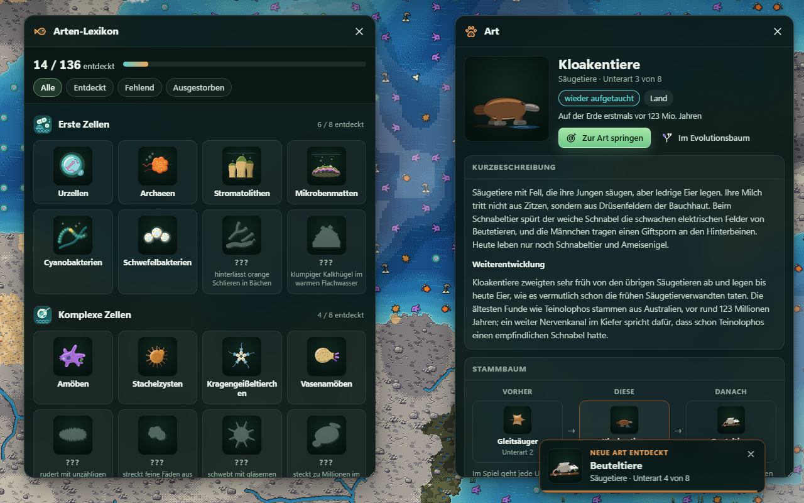
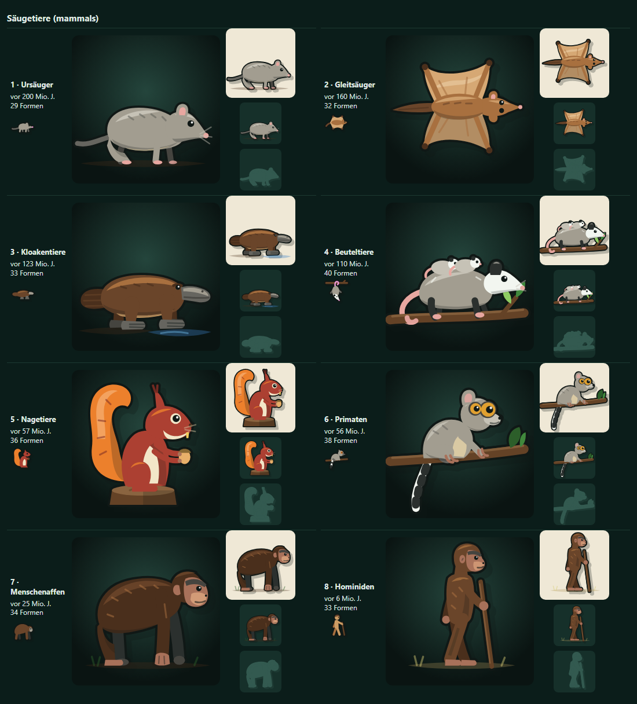
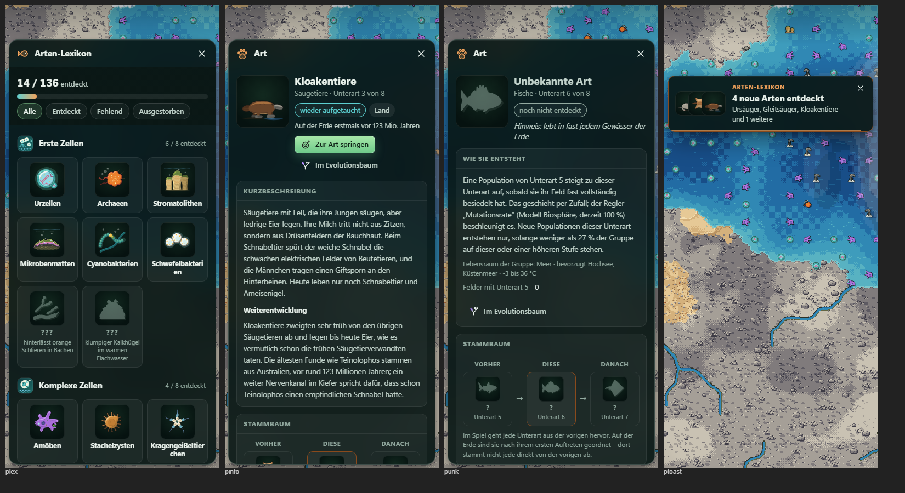

# Arten-Lexikon: Entdeckung, Infobox und Lexikon (Tierwelt)

Stand: 14. 10. 2026. Ab hier entdeckt der Spieler die 136 Unterarten der 17 Tier- und Einzellergruppen einzeln. Jede Entdeckung meldet sich klein und ohne das Spiel zu blockieren. Eine Infobox erklärt die Art, ein Lexikon zeigt den Fortschritt.

## Regeln

- **Entdeckung:** Eine Unterart gilt als entdeckt, sobald irgendwo auf dem Planeten eine Population auf ihrer Stufe lebt. Das prüft `FaunaDex.step` einmal je Tick, direkt nach `LifeSystem.stepLife`.
  - Jede Unterart löst bis zu einem neuen Planeten **genau einmal** eine Meldung aus. Das gilt auch, wenn sie ausstirbt und wiederkommt, und auch nach dem Laden.
- **Unterarten sind spielmechanisch kosmetisch:** Alle 8 Unterarten einer Gruppe teilen deren Spielwerte. Die Infobox zeigt deshalb nur Gruppenwerte, die Regel, nach der Unterarten entstehen, und die tatsächlichen Umstände der Entdeckung: Datum, Lebensraum, Temperatur des Feldes, Sauerstoff, Feld.
- **Aussterben einer Unterart:** Nach **20 Ticks** ohne Population wird sie still als ausgestorben markiert, ohne Meldung.
  - Der Wert ist gemessen: In einer Partie bis zur Gegenwart verschwinden Unterarten etwa 20-mal zeitweise, die Hälfte davon für höchstens 15 Ticks, die längste Lücke dauerte 286 Ticks.
  - Kommt sie wieder, gilt sie still als „wieder aufgetaucht“.
- **Aussterben einer ganzen Gruppe:** Es bleibt bei der bestehenden Karte „X ausgestorben“. Zusätzlich werden sofort alle entdeckten Einträge der Gruppe markiert.
- **Meldungen:**
  - Es ist immer nur eine kleine Meldung zugleich sichtbar.
  - Ab 3 wartenden Entdeckungen fasst eine Sammelmeldung sie zusammen.
  - Während eines Films oder Meilensteins warten die Meldungen. Eine Meldung, die kurz vorher erschien, tritt währenddessen zur Seite und kommt danach mit ihrer Restzeit wieder.
  - Meldungen, die beim Speichern noch warteten, etwa hinter einem Film, erscheinen nach dem Laden. Was schon zu sehen war, kommt nicht wieder.
  - Die Option „Bei Entdeckung pausieren“ ist standardmäßig aus.
- **Lexikon:** im Menü „Fenster“ oder mit der Taste A.
  - Unentdeckte Arten erscheinen als Silhouette mit einem vagen Hinweis.
  - Im Spiel geht jede Unterart aus der vorigen hervor. Die Reihenfolge folgt dem ersten Auftreten auf der Erde; dort ist sie keine direkte Ahnenreihe.
  - Taucht eine Unterart auf, deren Vorstufe nie beobachtet wurde, wird die Vorstufe mit eingetragen und als „nicht direkt beobachtet“ gekennzeichnet. Das kommt nur nach einer stillen Übernahme vor.

## Speicherstand

- Das Lexikon ist ein **optionales Feld `fauna`** im Spielstand. Die Formatnummer bleibt deshalb unverändert. Das Feld merkt sich auch, welche Meldungen noch nicht zu sehen waren.
  - Das ist eine bewusst freigegebene Ausnahme von der Regel in `AGENTS.md`: Das Feld ist abwärtskompatibel und kollidiert nicht mit Format 7 der Landschafts-Überarbeitung.
- Spielstände ohne dieses Feld, also ältere oder an dieser Stelle beschädigte, übernehmen beim Laden still alles, was gerade lebt.
  - Darunter liegende Stufen derselben Gruppe gelten dabei ebenfalls als entdeckt, weil sie existiert haben müssen. Stufen ohne lebende Population werden gleich als ausgestorben markiert.
  - Die Umstände der Entdeckung sind bei übernommenen Einträgen nicht überliefert; die Infobox sagt das.

## Inhalte

- **Texte:** `src/species/lore/<gruppe>.ts`. Je Unterart gibt es:
  - eine Beschreibung in 2–4 Sätzen
  - die Besonderheit ihrer Weiterentwicklung
  - einen vagen Hinweis für unentdeckte Einträge

  Die Texte sind gegen `quellenpruefung.md` geschrieben; unsichere Deutungen sind vorsichtig formuliert.
- **Portraits:** `src/species/portraits/<gruppe>.ts`, 64 × 64 Einheiten, 26–52 Formen. Den Stil beschreibt [portraitstil.md](portraitstil.md), Referenz ist das Säugetier-Set.

  

- **Spielwert-Texte:** `src/faunafacts.ts` liest sie aus denselben Tabellen wie die Simulation.

## Telefon

## Einschränkungen

- **Geprüft:**
  - nur in headless Chrome, am Desktop und bei 390 px Breite
  - keine anderen Browser, keine echten Touch-Geräte, kein Ton
- **Kamerafahrt** („Zur Art springen“): Geprüft wurden nur der kürzere Weg über den Kartenrand und das Ziel, mit einer Ersatz-Zeitsteuerung. Headless Chrome liefert keine verlässliche Bildfolge. Ob die Fahrt flüssig wirkt, muss jemand im echten Browser prüfen.
- **Silbentrennung:** Headless Chrome hat kein deutsches Trennwörterbuch. Lange Namen brechen dort auf 390 px mitten im Wort, zum Beispiel „Schwefelbakteri|en“. In normalen Browsern greift `hyphens: auto`; das ist ungeprüft.
- **Doppelte Formel:** Das Temperaturfenster in der Infobox (`faunaTempWindow`) wiederholt die Formel aus `LifeSystem.prepare`. Ändert sich `prepare`, schlägt `tests/faunadex.test.js` an.
